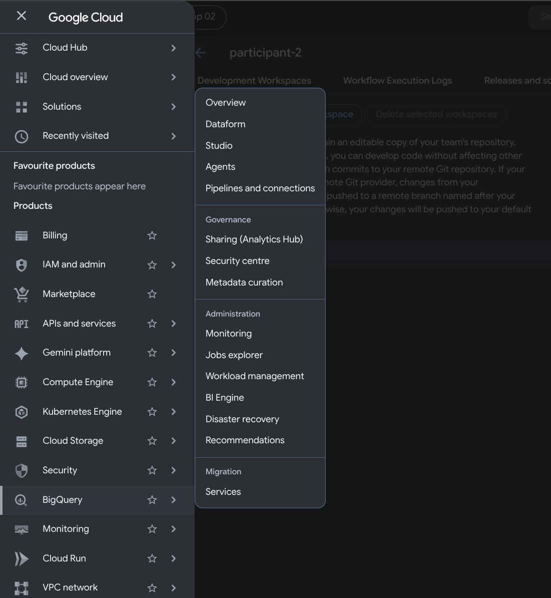
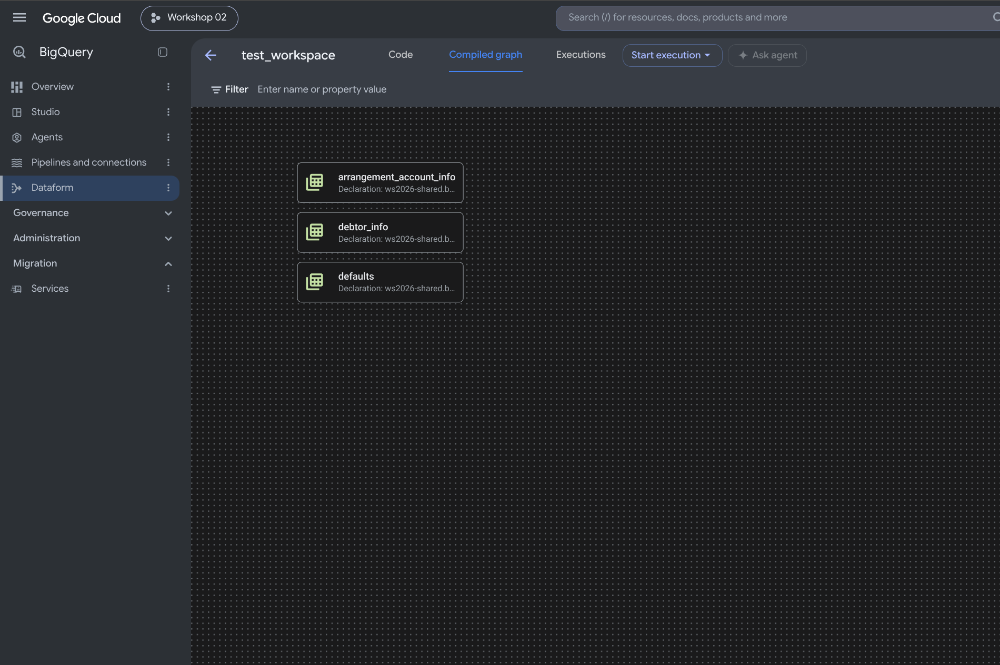
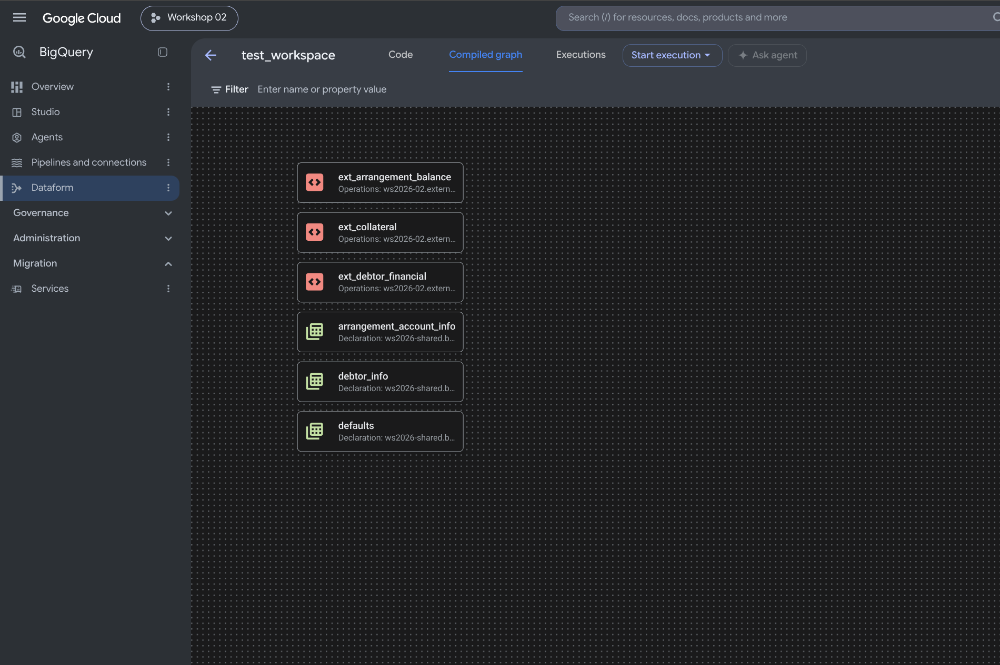
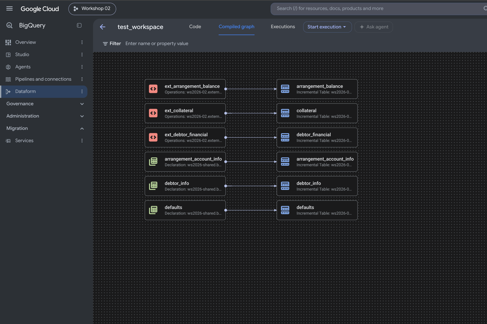
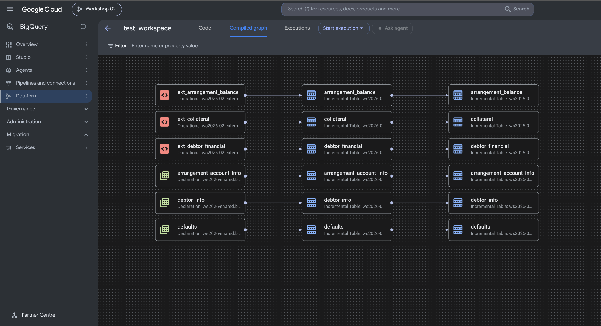
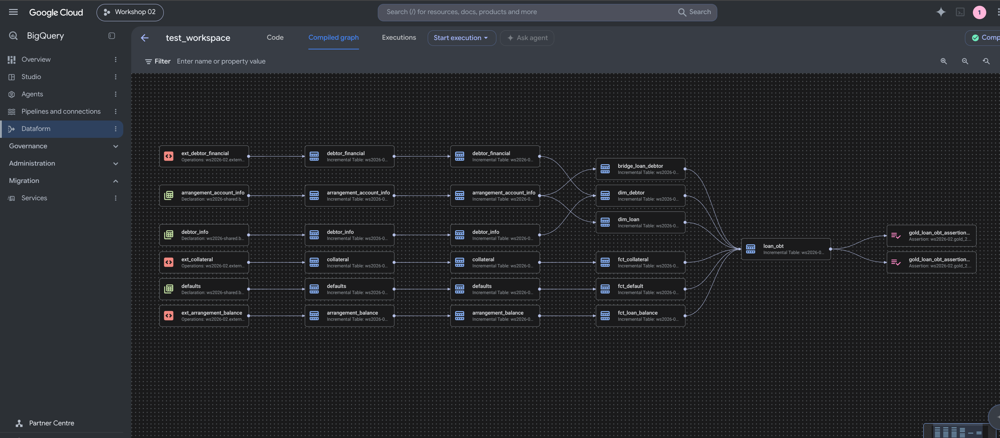
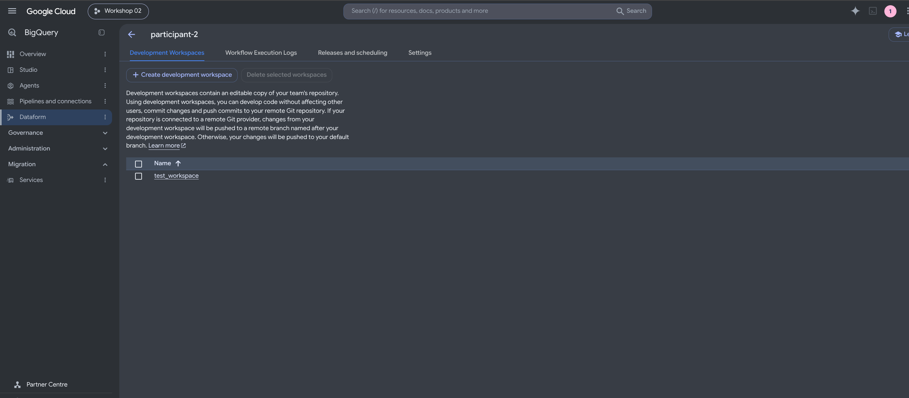
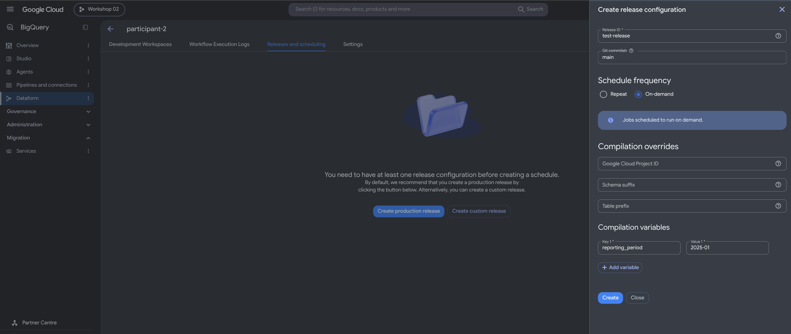

# Build a data warehouse with Dataform

In this workshop, build a warehouse from six synthetic banking sources. Three
are shared BigQuery tables and three are CSV files in Cloud Storage. Follow
the steps below to declare the sources, load them through bronze and silver,
and build the gold models.

The [`wokrshop_steps/`](wokrshop_steps/) folder contains the project files for
each step. These are cumulative snapshots: each later folder includes the files
from the earlier steps. Use the folders as references when creating or
checking files in your Dataform workspace.
Open the numbered folder for the stage you are working on and use
its files at the matching paths in your workspace.

## Open and configure your workspace

1. In Google Cloud Console, select Workshop 02 and open **Dataform**.
2. Open your assigned repository, `participant-N`, create a development
   workspace, and initialize it if prompted. Remove any sample definitions
   created during initialization so they do not run with the workshop.
3. Use the uploader below, or create the files manually using
   [step 1](wokrshop_steps/01-sources/).
4. For manual runs, choose **Execute with user credentials**.

The repository workspace override selects your project and adds your
participant number to output dataset names, such as `bronze_1`. Keep dataset
names unsuffixed in the SQLX files and workflow settings,



## Skip a step using Cloud shell

You can skip certain steps, if you are lazy and don't want to type out all of the sqlx files by hand.
I do recommend you to type out at least first couple of files in the step so that you fully understand what are we doing and the skip repetition.

To skip a step:

1. In Google Cloud Console, open **Activate Cloud Shell** and authorize it if
   prompted. Create and initialize your Dataform workspace first.
2. Download the uploader:

   ```sh
   curl -fsSLo upload_step.py https://raw.githubusercontent.com/SEBWorkshop2026/workshop_instructions/main/dataform/wokrshop_steps/upload_step.py
   ```
3. Run it with your participant number, your workspace ID and the step number:

   ```sh
   python3 upload_step.py --participant PARTICIPANT_NUMBER --workspace YOUR_WORKSPACE --step 1
   ```
   The uploader resets your files to match the step exactly.
4. Return to Dataform, check the workspace compilation and run the actions for
   the exercise with **Execute with user credentials**. Uploading only writes
   workspace files; it does not commit them or execute the workflow.

## Workshop steps

### 1. Declare the shared sources

Some of our sources are already in BigQuery, so we don't need to ingest them separately. However we must let dataform know where to get them from.

Apart from sources we will also implement a couple of helper functions. Like `reportingDate`, which converts `2025-03` into `2025-03-01`, to make the use of reporting_date consistant.

Use the files in [step 1](wokrshop_steps/01-sources/) to configure declarations for the three existing BigQuery
tables: `arrangement_account_info`, `debtor_info`, and `defaults`.


Compile the workspace and confirm that the declarations appear in the dependency graph without errors.



### 2. Create external tables

Our other three sources are a bit more tricky, we have to ingest them into bigquery from csv files.

We achieve this by creating an external table, which allows us to load structured and unstrucutered data for use in BigQuery.

Use [step 2](wokrshop_steps/02-external/) to add external tables for the three CSV sources in Cloud Storage. 

Run the workspace and confirm the external tables are available in the `external` dataset. These tables read CSV files
from the shared bucket; they do not copy all CSV rows into BigQuery.



### 3. Load the bronze layer

Now we are ready to ingest the data into our bronze layer. It is imporant to keep metadata about the ingestion, so that we can troubleshoot data issues if needed. We implement _ingested_at and _source_file attributes. Think what other metadata might be useful to include.

Use [step 3](wokrshop_steps/03-bronze/) to ingest the six sources into
monthly-partitioned bronze tables.

On a rerun, the model replaces that month's rows and leaves other reporting months intact. Run the
workspace and confirm the six tables are created in `bronze_N`.



### 4. Clean the data in silver

In this step we implement silver layer. Our synthetic data is quite clean so it might seem redundant, in real life it earns its' stay. For example converting integer based date into real date object. Deduplicating data. Pruning irrelevant attributes.

Use [step 4](wokrshop_steps/04-silver/) to add one silver model per bronze
table.

Run the workspace and confirm the six tables are created in `silver_N`; check that
the account origination and maturity columns are dates. For example, the
account dates arrive as `YYYYMMDD` values and are parsed into BigQuery `DATE`
columns here. The debtor identifier is also renamed to `debtor_id`, and
duplicate defaults within a reporting snapshot are removed.



### 5. Build the gold layer

This is where we build our star schema and derive the final dataset for our modelling purposes. Later on this can be expaneded by utillizing the star schema for other use cases. We also make use of simple dataform assertions, which allows us to check if our grain assumptions are correct and we didn't introduce any duplicates.

Use [step 5](wokrshop_steps/05-gold/) to build the dimensions, bridge, facts,
and the combined `loan_obt` snapshot. Run the workspace and confirm that the
gold models and assertions succeed. The `gold_N` dataset should contain the
star-schema tables, `loan_obt`, and assertion views.



## Create a release and run the pipeline

Use a release configuration to compile a pushed Git revision instead of
running directly from your development workspace. This is closer to a
production workflow: the release identifies the source revision and the
compilation settings used for the run.

1. In Dataform, open your development workspace's **Version control** pane.
   Commit **and push** your changes to the repository's default branch. A
   release compiles code from the remote Git branch, not unpushed workspace
   edits.
2. Return to the repository and select **Releases & scheduling**. Under
   **Release configurations**, click **Create**.
3. Give the release a unique ID, such as `period-2025-03`, and set **Git
   commitish** to the branch you pushed (usually `main`). Leave **Frequency**
   empty to make compilation on demand; this avoids automatically compiling
   the release on a schedule.
4. Under **Compilation variables**, add `reporting_period` with a value such
   as `2025-03`.
5. Click **Create**.
6. Open the release configuration and click **New compilation**. Confirm the
   new live compilation uses the pushed revision and the intended
   `reporting_period`.
7. Under **Releases & scheduling**, click **Start execution**, select the
   release configuration, and choose **All actions** to run the pipeline.
   Use an execution identity with access to the target BigQuery datasets and
   CSV bucket. Do not select **Run with full refresh** if you want to retain
   previously loaded months.




To load another month, create a separate release configuration with a unique
ID, such as `period-2025-04`, and set its `reporting_period` to `2025-04`.
Compile and execute each release on demand, one invocation at a time. The
monthly results are stored as separate reporting-date snapshots in the same
partitioned tables; a release configuration does not create a separate set of
tables for each month.

If you do not wish to run the whole historical pipeline by hand, you can just copy the full loan_obt from the shared project.

```sql
CREATE OR REPLACE TABLE ws2026-02.gold_2.loan_obt  AS SELECT * FROM ws2026-shared.banking_sample.loan_obt
```