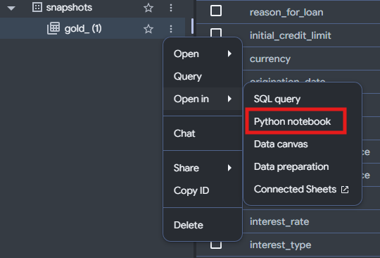
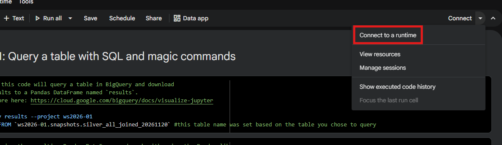
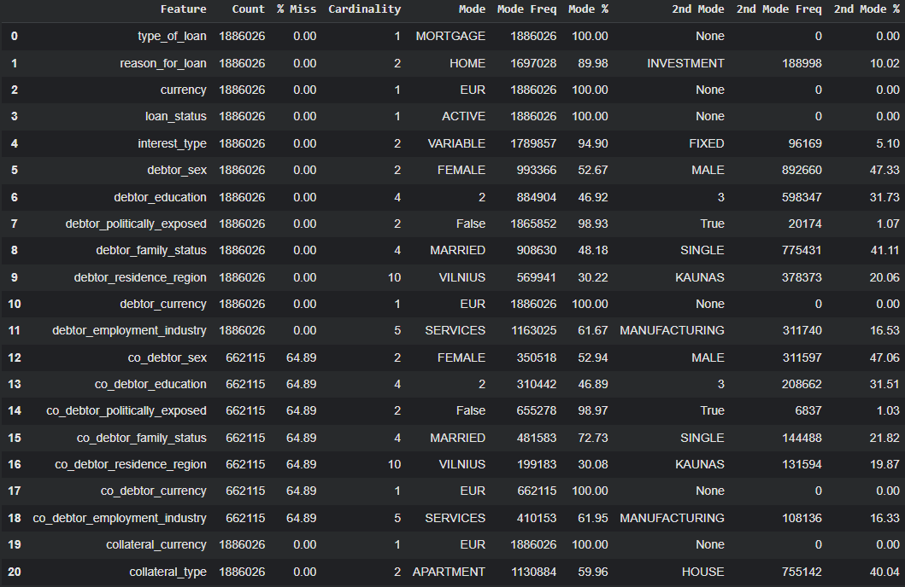
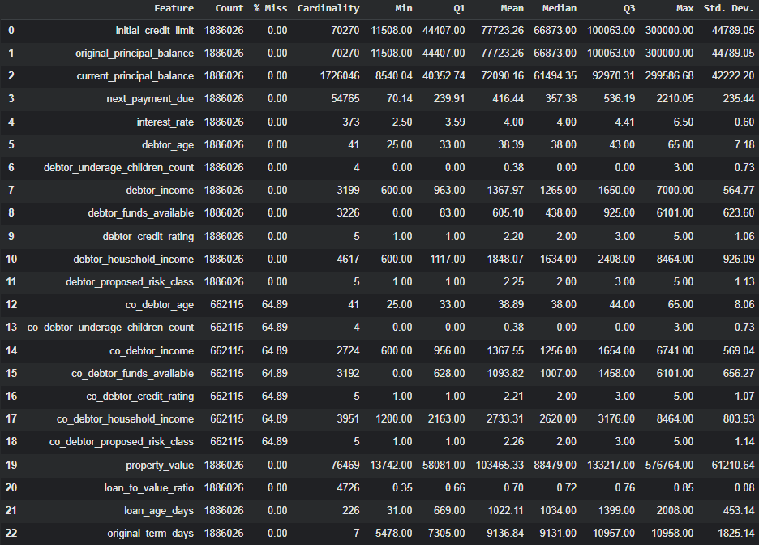
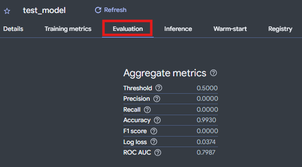

# Save a data snapshot for audit
Save the dataset that will be used for model training as a snapshot for audit purposes.
```sql
create snapshot table `{your_project}.{your_dataset}.{snapshot_table_name}`
clone `{your_project}.{gold_dataset_name}.{table_name}`
```

# Setup Python notebook in BigQuery Studio
## Open Python notebook
Go to your table snapshot Settings -> `Open in` -> `Python notebook`


## Setup notebook runtime
Press the arrow next to `Connect` -> `Connect to a runtime`



Choose `Create new Runtime`. There should be a template runtime already setup.


Scroll to the bottom and click `Create`

# Retrieve data using BigQuery DataFrames
Some of this code will be automatically generated when you open your notebook, but extra libraries and options need to be added.
## Import needed libraries
`bigframes.pandas` allows to retrieve any BigQuery table and use most of the Pandas features on it.
```python
import bigframes.pandas as bf
import pandas as pd
import numpy as np
from bigframes.bigquery import ml
from sklearn.metrics import roc_auc_score, roc_curve, log_loss

bf.options.bigquery.location = "{your_region}"
bf.options.bigquery.project = "{your_project}"
bf.options.display.max_columns = None  # show all columns
bf.options.bigquery.ordering_mode = "partial" # Opt out of ordering to make things cheaper (ordering is not needed for model training anyway)
```
## Read your data
```python
df = bf.read_gbq("{project}.{dataset}.{table}")
```
### Preview the data
You can add a codeblock like this after any data processing to check how the data looks. You can alternatively use `df.peek(5).T` to see all the columns listed.
```python
df
```

# Feature engineering
There are certain data transformations that can be done to prepare the data for model training. Most of these transformations are very data specific and could change even for a different subset of the same data. In order to identify the needed transformations, a comprehensive data analysis is done. Although BigQuery ML (BQML) already performs a lot of generic data preprocessing automatically, by doing the analysis and preprocessing manually, you can get a better performing model.
## Build a target
This step is not always required, but in our case there is no clear target feature, so we need to define it first.
```python
horizon_days = 180      # we choose 180 days as a prediction period (probability that the debtor will default within the next 180 days)

first_default = (
    df.groupby("loan_id")["default_date"]
    .min()
    .rename("first_default_date")
    .reset_index()
) # Debtors that already defaulted are still being reported in the future. So we have more than 1 row telling us that a debtor defaulted a loan. We only need the first occurrence.
df = df.merge(first_default, on="loan_id", how="left")

days_to_default = (df["first_default_date"] - df["reporting_date"]).dt.days

# Label on the unfiltered frame. This is our target (debtor defaulted 1/0)
df["defaulted"] = (
    df["first_default_date"].notna() & (days_to_default <= horizon_days)
).astype("Int64")

# Keep only rows still performing at the snapshot. Rows that report about debtors who already were reported as defaulted (for the same loan) in the past are dropped.
performing = df["first_default_date"].isna() | (days_to_default > 0)
df = df[performing].drop(columns=["first_default_date", "default_date"])

# Drop snapshots whose outcome window isn't fully observed
cutoff = df["reporting_date"].max() - pd.Timedelta(days=horizon_days)
df = df[df["reporting_date"] <= cutoff]
```
For a minimal setup using BQML this could be enough. You can skip ahead to [data splitting and model training step](#split-into-training-and-validation) and try to train a model on raw data just like that.

## Make more meaningful features from dates
Raw dates don't have a lot of meaning for the model training, they need some preprocessing
```python
df["loan_age_days"] = (df["reporting_date"] - df["origination_date"]).dt.days
df["original_term_days"] = (df["maturity_date"] - df["origination_date"]).dt.days

df.drop(["origination_date", "maturity_date", "inv_due_date"], axis=1, inplace=True)
```

## Drop ID columns
ID columns have no meaning for model training
```python
df.drop(["loan_id", "debtor_id", "co_debtor_id", "collateral_id", "property_id"], axis = 1, inplace = True)
```

## Categorical feature analysis
Statistical analysis of categorical features allows us to get a better look at the data and see what columns could be dropped or what other improvements could be made.
```python
def formatted_list(list):
    return [ '%.2f' % elem for elem in list ]

def bq_mode(df, dropna=True):
    """Mimics pandas.DataFrame.mode(axis=0) for a BigQuery DataFrame."""
    out = {}
    for col in df.columns:
        counts = df[col].value_counts(dropna=dropna)   # computed in BigQuery
        top = counts.max()
        modes = counts[counts == top].sort_index().to_pandas()  # only tied values come back
        out[col] = pd.Series(modes.index.to_numpy())
    # Series of unequal length are padded with NaN, same as pandas mode()
    return pd.DataFrame(out)

def categorical_features_analysis(data):

    categorical = data[["type_of_loan", "reason_for_loan", "currency",
                        "loan_status", "interest_type", "debtor_sex",
                        "debtor_education", "debtor_politically_exposed",
                        "debtor_family_status", "debtor_residence_region",
                        "debtor_currency", "debtor_employment_industry",
                        "co_debtor_sex", "co_debtor_education",
                        "co_debtor_politically_exposed", "co_debtor_family_status",
                        "co_debtor_residence_region", "co_debtor_currency",
                        "co_debtor_employment_industry",
                        "collateral_currency", "collateral_type"]]

    categorical_features_analysis_df = pd.DataFrame(columns=['Feature','Count','% Miss',
                                                        'Cardinality','Mode','Mode Freq',
                                                        'Mode %','2nd Mode',
                                                        '2nd Mode Freq','2nd Mode %'])
    categorical_features_analysis_df['Feature'] = categorical.columns
    categorical_features_analysis_df['Count'] = categorical.count().tolist()

    missing_list_categorical = list(categorical.isnull().sum() * 100 / len(categorical))
    missing_list_categorical = formatted_list(missing_list_categorical)
    categorical_features_analysis_df['% Miss'] = missing_list_categorical

    categorical_features_analysis_df['Cardinality'] = categorical.nunique().tolist()

    mode = bq_mode(categorical)
    categorical_features_analysis_df['Mode'] = mode.iloc[0].tolist()

    mode_freq_list = []
    for column in categorical.columns:
        mode_freq_list.append((categorical[column] == mode[column].iloc[0]).sum())
    categorical_features_analysis_df['Mode Freq'] = mode_freq_list

    mode_percentage_list = categorical_features_analysis_df['Mode Freq'] / categorical.count().tolist() * 100
    mode_percentage_list = formatted_list(mode_percentage_list)
    categorical_features_analysis_df['Mode %'] = mode_percentage_list

    second_mode_list = []
    second_mode_freq_list = []

    for column in categorical.columns:
        counts = categorical[column].value_counts().head(2).to_pandas()
        if len(counts) > 1:
            second_mode_list.append(counts.index[1])
            second_mode_freq_list.append(counts.iloc[1])
        else:
            second_mode_list.append(None)
            second_mode_freq_list.append(0)

    categorical_features_analysis_df['2nd Mode'] = second_mode_list
    categorical_features_analysis_df['2nd Mode Freq'] = second_mode_freq_list

    second_mode_percentage_list = categorical_features_analysis_df['2nd Mode Freq'] / categorical.count().tolist() * 100
    second_mode_percentage_list = formatted_list(second_mode_percentage_list)
    categorical_features_analysis_df['2nd Mode %'] = second_mode_percentage_list

    return categorical_features_analysis_df

categorical_features_analysis_df = categorical_features_analysis(df)
```
### Review the analysis table
```python
categorical_features_analysis_df
```


## Categorical feature preprocessing
Looking at the output we see multiple ways to optimize categorical features for model training:
- Multiple columns have Cardinality == 1. If the values never change, these columns have no value as features, they can be dropped.
- Columns with Cardinality == 2 are in fact binary columns and their values can be changed to 1/0.
- `debtor_residence_region` Cardinality is 10, but the 1st and 2nd Modes are over 50% of data. We can One-hot encode just the 1st and 2nd Mode and categorize everything else as `OTHER`.
- all `co_debtor_...` columns have less than 40% of values available. Might be good to drop them, alternatively they can also be One-hot encoded. We chose to drop them to make the data model more simple.
- since we are dropping `co_debtor_...` we are introducing `has_co_debtor` flag feature as a representation.
```python
binary_cols = {"reason_for_loan": "INVESTMENT", "interest_type": "FIXED",
               "debtor_sex": "MALE", "collateral_type": "HOUSE"}

bool_cols = ["debtor_politically_exposed"]

onehot_cols = ["debtor_education", "debtor_family_status",
               "debtor_employment_industry"]

co_cols = ["co_debtor_sex", "co_debtor_education", "co_debtor_family_status",
               "co_debtor_residence_region", "co_debtor_employment_industry",
           "co_debtor_politically_exposed", ]

# 1. flag first, before any filling
df = df.assign(has_co_debtor=df["co_debtor_age"].notna().astype("Int64"))

# 2. two-level columns and booleans -> 0/1 (NULL -> 0)
for c, positive in binary_cols.items():
    df[c] = (df[c] == positive).fillna(False).astype("Int64")
for c in bool_cols:
    df[c] = df[c].fillna(False).astype("Int64")

# 3. one-hot, dropping the most frequent level as the reference
for c in onehot_cols:
    levels = df[c].value_counts().to_pandas().index.tolist()   # small result, sorted by frequency
    for lvl in levels[1:]:
        df[f"{c}_{lvl}"] = (df[c] == lvl).fillna(False).astype("Int64")

# 4. one-hot region to only 3 groups instead of 10
region = df["debtor_residence_region"]
df["region_group"] = region.where(region.isin(["VILNIUS", "KAUNAS"]), "OTHER")

# OTHER as the reference level, so coefficients read as "vs. the rest"
df["region_VILNIUS"] = (df["region_group"] == "VILNIUS").astype("Int64")
df["region_KAUNAS"]  = (df["region_group"] == "KAUNAS").astype("Int64")

df = df.drop(columns=["debtor_residence_region", "region_group"])

# Columns with cardinality == 1 can be safely dropped
columns_to_drop = categorical_features_analysis_df[categorical_features_analysis_df['Cardinality'] == 1]['Feature'].tolist()
df = df.drop(columns=columns_to_drop + onehot_cols + co_cols)
```

## Numerical feature analysis
In a similar manner we can review the numerical features too.
```python
def numerical_features_analysis(data):

    numerical = data[["initial_credit_limit", "original_principal_balance",
                "current_principal_balance", "next_payment_due",
                "interest_rate", "debtor_age",
                "debtor_underage_children_count",
                "debtor_income", "debtor_funds_available",
                "debtor_credit_rating", "debtor_household_income",
                "debtor_proposed_risk_class",
                "co_debtor_age", "co_debtor_underage_children_count",
                "co_debtor_income", "co_debtor_funds_available",
                "co_debtor_credit_rating", "co_debtor_household_income",
                "co_debtor_proposed_risk_class",
                "property_value", "loan_to_value_ratio",
                "loan_age_days", "original_term_days"]]

    select = ",\n".join(
    f"APPROX_QUANTILES(`{c}`, 4) AS `{c}`" for c in numerical.columns
    )
    q = bf.read_gbq(f"SELECT {select} FROM ({numerical.sql})").to_pandas()
    arrs = q.iloc[0]
    quant = pd.DataFrame(
        [list(a) for a in arrs],
        index=arrs.index,
        columns=["min", "q1", "median", "q3", "max"],
    )

    out = pd.DataFrame({
        "Feature":     numerical.columns,
        "Count":       numerical.count().to_numpy(),
        "% Miss":      (numerical.isnull().mean() * 100).round(2).to_numpy(),
        "Cardinality": numerical.nunique().to_numpy(),
        "Min":         formatted_list(quant["min"].tolist()),
        "Q1":          formatted_list(quant["q1"].tolist()),
        "Mean":        formatted_list(numerical.mean().tolist()),
        "Median":      formatted_list(quant["median"].tolist()),
        "Q3":          formatted_list(quant["q3"].tolist()),
        "Max":         formatted_list(quant["max"].tolist()),
        "Std. Dev.":   formatted_list(numerical.std().tolist()),
    })
    return out

numerical_features_analysis_df = numerical_features_analysis(df)
```
```python
numerical_features_analysis_df
```
## Numerical feature preprocessing
For this example we are only dropping the `co_debtor_...` columns due to missing values and simplicity. They don't have to be dropped necessarily though and more improvements could be done (for example one-hot encoding low cardinality features).
```python
co_num = ["co_debtor_age", "co_debtor_underage_children_count",
                "co_debtor_income", "co_debtor_funds_available",
                "co_debtor_credit_rating", "co_debtor_household_income",
                "co_debtor_proposed_risk_class"]
df.drop(columns=co_num, inplace=True)
```


## Correlation analysis
Creating correlation matrix can help to identify redundant features.
```python
corr_matrix = (
    df.drop(columns="reporting_date")
      .corr(method="pearson")
      .to_pandas()
      .astype("float64")
)
corr_matrix
```
Correlation matrix with high feature count can be hard to analyze. We can create a table to show top correlating features.
```python
upper = corr_matrix.where(np.triu(np.ones(corr_matrix.shape, dtype=bool), k=1))
pairs = upper.stack().rename("corr").reset_index()
pairs.columns = ["feature_1", "feature_2", "corr"]

high = pairs[pairs["corr"].abs() > 0.8].sort_values("corr", key=abs, ascending=False)
print(high.to_string())
```
We can also inspect feature to target correlations. High feature to target correlation could represent a target leakage.
```python
target = "defaulted" 
corr_matrix[target].drop(target).sort_values(key=abs, ascending=False).head(25)
```

### Drop redundant or target leaking features
```python
columns_to_drop = ["initial_credit_limit", "original_principal_balance",
                   "property_value",
                   "next_payment_due", "debtor_proposed_risk_class",
                   "debtor_household_income"] # Change this according to your analysis and results
df.drop(columns=columns_to_drop, inplace=True)
```

## Split into training and validation
Usually we would split data on a percentage that we want for training and validation (60-40, 70-30, 80-20). Here we have a timeline representation and it makes more sense to train a model to predict future from the past, so we build splits based on that timeline.
```python
max_date = df["reporting_date"].max()                      # 2026-01-01
df = df[df["reporting_date"] <= "2025-07-01"]  # outcomes known

train = df[df["reporting_date"] <= "2024-12-01"]           # 12 snapshots
# 6-month gap: 2025-01 to 2025-06 skipped
valid = df[df["reporting_date"] >= "2025-07-01"]           # last labeled snap

train.drop(columns="reporting_date", inplace=True)
valid.drop(columns="reporting_date", inplace=True)
```
### Review splits
```python
train
```
```python
valid
```

# Model Training
And with this the data is prepared for model training. Here we chose to train Logistic Regression model. You can try different ones to see which one fits best for you. By default BQML does early stop and quits the training when it stops converging. You can turn off this feature by adding a flag `"early_stop": False`. You can find more about Logistic Regression in BQML [here](https://docs.cloud.google.com/bigquery/docs/logistic-regression-prediction).
```python
train_df = train.assign(is_valid=False)
valid_df = valid.assign(is_valid=True)
combined = bf.concat([train_df, valid_df])

ml.create_model(
    '{project}.{dataset}.{model_name}',
    options={
        "model_type": "LOGISTIC_REG",
        "enable_global_explain": True,
        "data_split_method": "CUSTOM",
        "data_split_col": "is_valid",
        "input_label_cols": ["defaulted"],
        "max_iterations": 15,
    },
    training_data=combined,
    replace=True,
)
```

## Model evaluation
The most relevant metric for this model should be ROC AUC.
ROC AUC metric represents our model best here because:
- It doesn't depend on a threshold. Model's probabilities are all far below 0.5, so threshold metrics (precision, recall, accuracy) come out as 0 or meaningless. AUC measures the ordering only, so the 0.5 problem doesn't affect it.
- It isn't distorted by the 0.7% base rate. Accuracy looks great (99.3%) for a model that does nothing. AUC for that model would be 0.5.
- It matches how PD models are used. They are often used to rank borrowers, set risk tiers or cut off the worst applicants. That is a ranking task. Gini (2 × AUC − 1) is the standard way credit risk reports it.

### Using BigFrames (within Python notebook)
```python
ml.evaluate(
    '{project}.{dataset}.{model_name}',
    input_=valid,
)
```

### In BigQuery Studio
Choose your model and click on it


Open the Evaluation tab



## Using the model for predictions
Prediction probabilities (predicted_defaulted_probs) is something that we want to look at here.
```python
ml.predict(
    'ws2026-01.models.test_model',
    input_=valid,
)
```
## Extra model evaluations using predictions
Look for:
- `AUC`, `Gini`, `KS` - the higher the better
- `mean PD` close to `actual rate`
- `log loss` to be lower than `baseline`
```python
preds = ml.predict('{project}.{dataset}.{model}', valid).to_pandas()
print(preds.columns.tolist())   # expect predicted_defaulted and predicted_defaulted_probs

# probs is an array of {label, prob}; take the one for label 1
preds["pd"] = preds["predicted_defaulted_probs"].apply(
    lambda arr: next(x["prob"] for x in arr if x["label"] == 1))
y = preds["defaulted"].astype(int)

auc = roc_auc_score(y, preds["pd"])
fpr, tpr, _ = roc_curve(y, preds["pd"])
print("AUC", auc, "Gini", 2*auc - 1, "KS", (tpr - fpr).max())
print("mean PD", preds["pd"].mean(), "actual rate", y.mean())
print("log loss", log_loss(y, preds["pd"]), "baseline", log_loss(y, [y.mean()]*len(y)))

# decile table: 10 = riskiest
preds["decile"] = pd.qcut(preds["pd"].rank(method="first"), 10, labels=False) + 1
print(preds.groupby("decile").agg(n=("pd", "size"),
                                  avg_pd=("pd", "mean"),
                                  default_rate=("defaulted", "mean")))
```
